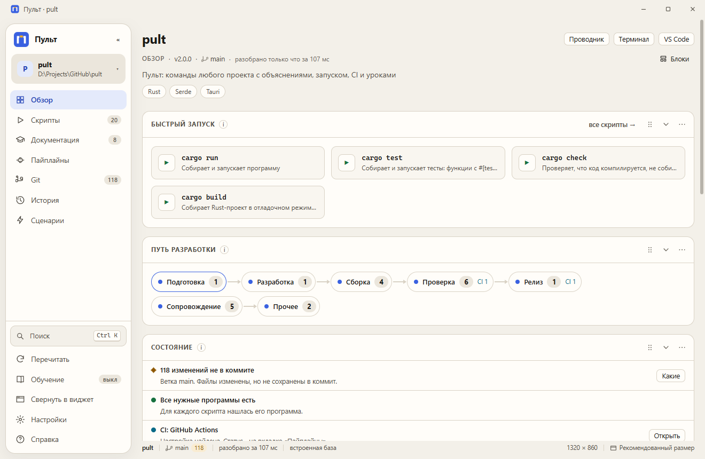
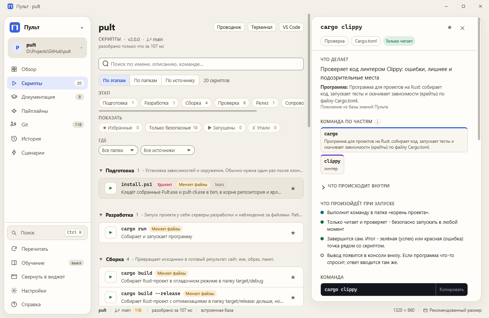
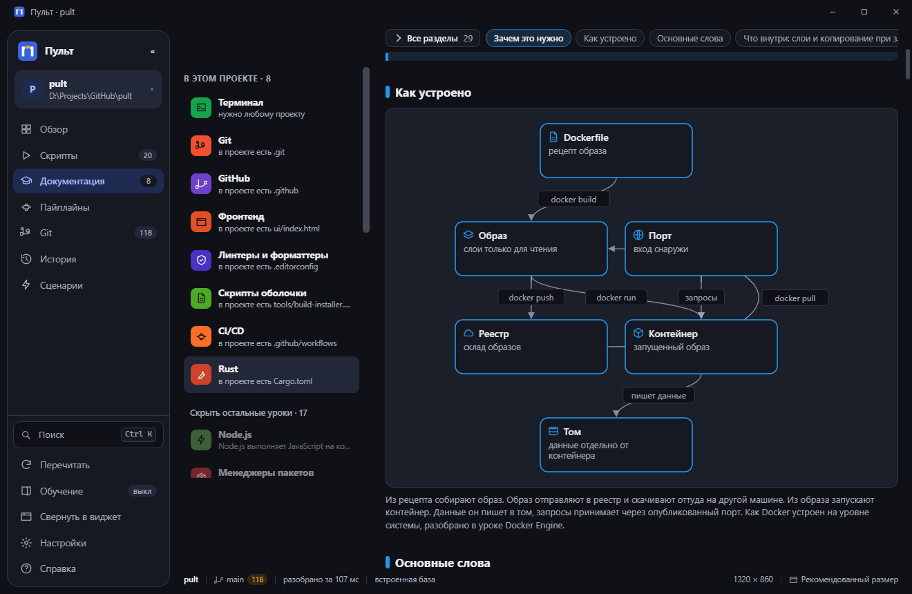

<p align="center">
  
</p>

<p align="center">
  <a href="https://github.com/DotNotFact/pult/actions/workflows/ci.yml"></a>
  <a href="https://github.com/DotNotFact/pult/releases/latest"></a>
  <a href="LICENSE"></a>
  
</p>

Открываете папку любого проекта, и Пульт находит всё, что в нём можно запустить:
скрипты `package.json`, цели `Makefile` и `justfile`, файлы `.ps1` и `.sh`, джобы CI.
Каждую команду он разбирает по частям и объясняет простыми словами: что она делает,
что значат ключи, что поменяет на диске. Запускает с живой консолью, показывает
пайплайн GitLab или GitHub, а рядом даёт короткие уроки по технологиям проекта
со схемами и вопросами.

Работает без интернета. Объяснения лежат в JSON, а не в коде, поэтому любой проект
получает их одинаково.



<details>
<summary>In English</summary>

Pult opens any project folder, finds every runnable command (npm scripts, Makefile
and justfile targets, shell and PowerShell scripts, CI jobs) and explains each one
piece by piece in plain words: what it does, what its flags mean, what it changes on
disk. It runs commands with a live console, shows GitLab and GitHub pipelines, and
teaches the technologies the project uses with short illustrated lessons. Everything
works offline; explanations come from a JSON knowledge base, not hardcoded rules.
The interface and lessons are in Russian for now.

</details>

## Установка

**Установщик** - обычный способ.

1. Скачайте `Pult_<версия>_x64-setup.exe` со страницы [Releases](https://github.com/DotNotFact/pult/releases/latest).
2. Запустите его. Права администратора не нужны: Пульт ставится только для вас, в
   `%LOCALAPPDATA%\Programs\Pult`.
3. На первой странице можно оставить флажок «Добавить команду pult в PATH» - тогда `pult`
   работает в любом новом терминале. На последней - ярлык на рабочем столе.

Ярлык «Pult» появится в меню «Пуск». Если WebView2 на машине нет (в Windows 11 он есть
всегда, в Windows 10 почти всегда), установщик поставит его сам, для этого нужен интернет.
Новая версия ставится поверх старой, настройки и история остаются.

**Переносная версия** - без установки: скачайте `pult-<версия>-windows-x64.zip`, распакуйте
в любую папку и запустите `Pult.exe`. Команду `pult` даёт `bin\pult.cmd`: добавьте папку `bin` в PATH,
и `pult` заработает в любом терминале.

Суммы файлов для проверки - в `SHA256SUMS.txt` рядом с ними в релизе:
`Get-FileHash Pult_<версия>_x64-setup.exe` должен совпасть со строкой из файла.

Тихая установка для скриптов: `Pult_<версия>_x64-setup.exe /S` (ключ `/ADDTOPATH` добавит
`bin` в PATH, `/D=путь` в конце строки выберет другую папку).

### Где Пульт хранит данные

| Что | Где |
|---|---|
| программа (установщик) | `%LOCALAPPDATA%\Programs\Pult` |
| настройки, недавние проекты, история, кэш | `%LOCALAPPDATA%\dev.dotnotfact.pult\data` |
| данные окна (WebView2) | `%LOCALAPPDATA%\dev.dotnotfact.pult\EBWebView` |
| размер и место окна | `%APPDATA%\dev.dotnotfact.pult` |

Переносная версия пишет данные туда же, поэтому zip и установщик можно менять местами без
потери настроек.

### Удаление

«Параметры - Приложения - Установленные приложения - Pult - Удалить». Пульт закроется сам и
спросит: «Удалить также настройки, историю и кэш Пульта?». «Да» удаляет всё, «Нет» оставляет
данные, и после новой установки всё вернётся. В любом случае уходят программа, ярлыки, запись
в PATH и значок в трее.

Тихо: `%LOCALAPPDATA%\Programs\Pult\uninstall.exe /S` оставляет данные, с ключом `/WIPEDATA`
удаляет и их.

Переносную версию удаляют вместе с папкой, а данные - удалив две папки
`dev.dotnotfact.pult` из таблицы выше.

## Что внутри

| Раздел | Что показывает |
|---|---|
| **Обзор** | быстрый запуск, путь разработки по этапам, что в проекте не так и как это исправить |
| **Скрипты** | все команды с поиском и фильтрами. Клик открывает разбор: команда по частям, ключи, что произойдёт, прошлые запуски |
| **Документация** | уроки по технологиям, найденным в проекте: git, Docker, CI/CD, .NET, Node, Rust и другие |
| **Пайплайны** | статус GitLab или GitHub, этапы и джобы. Журнал джобы открывается в консоли окна |
| **Git** и **История** | ветка, изменения, коммиты, прошлые запуски |
| **Сценарии** | свои цепочки команд: несколько скриптов по очереди одной кнопкой, ход по шагам. Пульт может сам предложить популярные цепочки по скриптам проекта |
| **Виджет** | окно меньше 360 x 300 становится карточкой с самым нужным: что идёт, быстрый запуск, сценарии, CI, git. Кнопка «Свернуть в виджет» - в боковой панели |

Значок Пульта в трее запускает сценарии, даже когда окно скрыто; крестик окна может
прятать его в трей (флажок в настройках).

Блоки «Обзора» можно перетаскивать, сворачивать и прятать. В настройках есть два
противоположных режима: обучение (подробно, с подсказками к терминам) и минимальный
интерфейс (только кнопки и данные).

<table>
  <tr>
    <td></td>
    <td></td>
  </tr>
  <tr>
    <td align="center"><sub>Скрипт по частям</sub></td>
    <td align="center"><sub>Урок со схемой</sub></td>
  </tr>
</table>

Если включить **режим обучения**, термины в тексте подчёркиваются и раскрываются при
наведении, а у каждого скрипта открыт блок «что происходит внутри».

Откуда Пульт берёт объяснения:

1. **База знаний** в `knowledge/`: программы, их подкоманды и ключи.
2. **Сам файл скрипта**: шапка-комментарий и что код делает с файлами и сетью.
3. **Пакет в `node_modules`**, если программы нет в базе: описание от её авторов.
4. **Справка программы**: кнопка «Спросить у программы» запускает справку - для подкоманды её собственную (`git status -h`, `cargo check --help`) - и разбирает ключи.

## Терминал

Рядом с окном ставится консольная версия, `pult-cli.exe`. Команда `pult` - это `bin\pult.cmd`, она
зовёт её коротко из любой папки, если `bin` в PATH (флажок установщика):

```
pult                     экран в терминале: обзор, скрипты, CI, уроки, проекты
pult info                сводка по проекту
pult ls [поиск]          скрипты с объяснениями
pult explain <скрипт>    команда по частям, ключи, что произойдёт
pult run <скрипт> -- арг запуск, код выхода сохраняется
pult ci [номер]          пайплайны и джобы; pult ci log <джоба>
pult learn [урок]        уроки прямо в терминале
pult ui [путь]           открыть окно
```

Папку проекта можно передать ключом `-C путь`, иначе берётся текущая.

## Безопасность

Пульт открывает чужие папки, поэтому он осторожен:

- окно говорит с ядром через IPC Tauri, сервера и открытого порта нет;
- команды запускаются без оболочки, списком аргументов, и имя файла не станет второй командой;
- до запуска git Пульт сам читает `.git/config`: если там фильтры, свои программы для подписи, include и похожее, git не запускается, пока вы не нажмёте «Доверять этому репозиторию»;
- справка `--help` программы из самого проекта запускается только после подтверждения с полным путём к файлу;
- адрес репозитория проверяется, и `gh`/`glab` получают сервер явно - чужой remote не уведёт ваш токен;
- «Стоп» гасит всё дерево процессов;
- `.env` не читается, сетевые папки не открываются, запросы CI уходят только на доверенные серверы.

Нашли дыру? Порядок описан в [SECURITY.md](SECURITY.md).

## Скорость

| Что | Сколько |
|---|---|
| Загрузка базы знаний | около 17 мс |
| Разбор крупного проекта: 105 скриптов с объяснениями | около 190 мс, из них 140 мс уходит на git |
| Повторное открытие | сразу из кэша, свежий разбор идёт фоном |

Замерено на одном проекте и одной машине, это ориентир, а не обещание.

## Сборка из исходников

Нужны Rust stable и Node 22 (Node только для проверки базы знаний).

```bash
cargo build --release -p pult-app -p pult-cli
pwsh -File tools/install.ps1
```

Второй шаг кладёт `Pult.exe`, `pult-cli.exe` и `pult.cmd` в `bin\` и создаёт ярлыки на
рабочем столе. Архив как в релизе собирает `pwsh -File tools/package.ps1`, установщик -
`pwsh -File tools/build-installer.ps1` (Tauri CLI он берёт через `npx`, глобально ничего не ставит).

| Папка | Что внутри |
|---|---|
| `core/` | ядро на Rust: разбор проекта, объяснения, git, CI, запуск процессов |
| `app/` | окно на Tauri 2 |
| `cli/` | терминальная версия на ratatui |
| `ui/` | интерфейс окна |
| `knowledge/` | база знаний в JSON и её проверка |

Настройки, история и кэш хранятся в `%LOCALAPPDATA%\dev.dotnotfact.pult\data`.
Подробнее об устройстве: [docs/ARCHITECTURE.md](docs/ARCHITECTURE.md).

## Как помочь

Самое полезное - научить Пульт программе, которую он не знает. Для этого не нужен Rust,
хватит JSON-файла в `knowledge/`. Как это сделать, описано в [CONTRIBUTING.md](CONTRIBUTING.md).

## Лицензия

[MIT](LICENSE)
